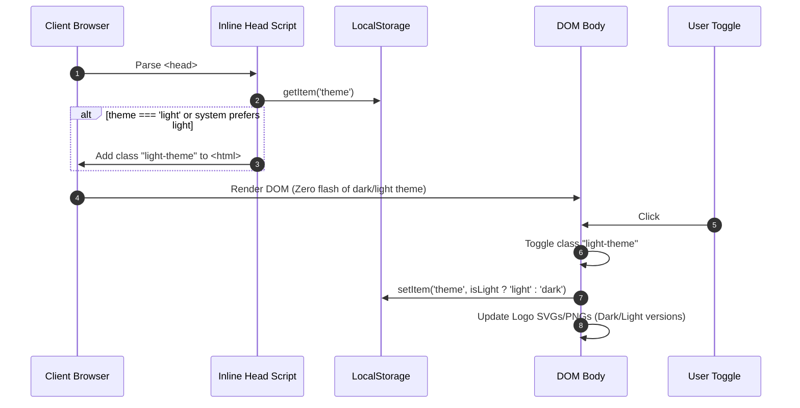
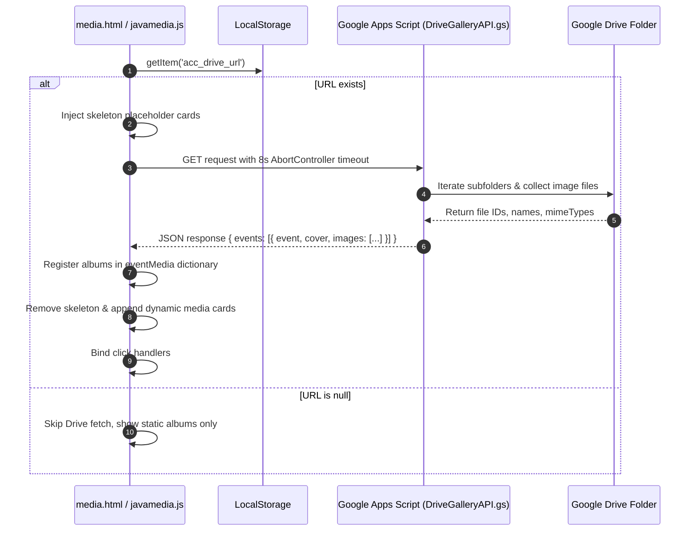

# Association of Christian Christites (ACC) — Full Architecture & Rebuild Blueprint

> **Complete Reverse-Engineering Technical Specification & System Blueprint**  
> *Targeted for a modern End-to-End TypeScript Rebuild (e.g., Next.js / Vite + React / Astro / SvelteKit / Vue)*

---

## Table of Contents

1. [Executive Summary & Purpose](#1-executive-summary--purpose)
2. [Project File Map & "What is Where"](#2-project-file-map--what-is-where)
3. [Global Design System & UI/UX Tokens](#3-global-design-system--uiux-tokens)
4. [Data Architecture & LocalStorage Schema](#4-data-architecture--localstorage-schema)
5. [Page-by-Page Breakdown & Component Hierarchy](#5-page-by-page-breakdown--component-hierarchy)
   - 5.1. [Global Layout (Header, Mobile Drawer, Footer)](#51-global-layout-header-mobile-drawer-footer)
   - 5.2. [Home / Landing Page (`index.html`)](#52-home--landing-page-indexhtml)
   - 5.3. [About Us Page (`about.html`)](#53-about-us-page-abouthtml)
   - 5.4. [Domains Portal (`domains.html`)](#54-domains-portal-domainshtml)
   - 5.5. [Prayers Hub (`prayer.html`)](#55-prayers-hub-prayerhtml)
   - 5.6. [Events Calendar (`calendar.html`)](#56-events-calendar-calendarhtml)
   - 5.7. [Media Gallery & Lightbox (`media.html`)](#57-media-gallery--lightbox-mediahtml)
   - 5.8. [Contact Us & Form Submission (`contactus.html` & `success.html`)](#58-contact-us--form-submission-contactushtml--successhtml)
   - 5.9. [Admin Dashboard Portal (`/admin/index.html`)](#59-admin-dashboard-portal-adminindexhtml)
6. [Dynamic Flows & Interactive Logic](#6-dynamic-flows--interactive-logic)
   - 6.1. [Theme Switching Engine & FOUC Prevention](#61-theme-switching-engine--fouc-prevention)
   - 6.2. [Hero Rotating Word & Animation Pipeline](#62-hero-rotating-word--animation-pipeline)
   - 6.3. [Bible Verse Rotator](#63-bible-verse-rotator)
   - 6.4. [Calendar Engine Algorithm & Filtering](#64-calendar-engine-algorithm--filtering)
   - 6.5. [Media Lightbox Engine & Video Handling](#65-media-lightbox-engine--video-handling)
   - 6.6. [Google Drive Gallery Apps Script Integration](#66-google-drive-gallery-apps-script-integration)
   - 6.7. [Contact Form Validation & Google Apps Script Dispatch](#67-contact-form-validation--google-apps-script-dispatch)
   - 6.8. [Admin Authentication & Secret Entry Triggers](#68-admin-authentication--secret-entry-triggers)
7. [TypeScript Type Definitions & API Interfaces](#7-typescript-type-definitions--api-interfaces)
8. [Recommended Modern TypeScript Architecture Plan](#8-recommended-modern-typescript-architecture-plan)

---

## 1. Executive Summary & Purpose

The **Association of Christian Christites (ACC)** portal is an institutional faith, community, and service web platform representing over 5,000 Christian students at **CHRIST (Deemed to be University)**, primarily Kengeri Campus in Bengaluru, India.

### Key Objectives & High-Level Architecture
- **Multi-domain showcase:** 6 dedicated ministries/domains (*Animation, Liturgy, Outreach, Audio & Visual, Logistics & Hospitality, Media & Documentation*).
- **Liturgical & Community Calendar:** Interactive calendar with dynamic month calculations, filtering, and pre-seeded Christian feast days + university events.
- **Prayer Directory:** Categorized, structured liturgical prayers and devotions with interactive leader/congregation dialogue formatting.
- **Dynamic Media Portal:** Custom media lightbox supporting both bundled video/images and dynamic Google Drive API integration via Google Apps Script.
- **Client-side DB & Admin CMS:** Zero-backend administrative interface powered by `localStorage` persistence and fallback baseline seeding.
- **Custom Theming:** Dual Dark/Light aesthetic optimized with flame orange/gold accents, ambient glow elements, and glassmorphic cards.

---

## 2. Project File Map & "What is Where"

```plaintext
ACC_website/
├── index.html                  # Landing page: Video hero, rotating verse, teaser about, 7 service timings, owl carousel events
├── about.html                  # About page: Origin story, Mission/Vision quote grid, dynamic 4-tier Core Team roster
├── domains.html                # Unified domain tabs (Animation, Liturgy, Outreach, Audio-Visual, Logistics, Media-Doc)
├── prayer.html                 # Liturgical prayer directory: Sticky category nav, accordion prayer dialogs (Our Father, Rosary, etc.)
├── paryer.html                 # Typo-resilience redirect stub -> redirects to prayer.html
├── calendar.html               # Custom interactive calendar grid, event side-panel, category filters, hidden admin triggers
├── media.html                  # Event galleries, custom full-screen lightbox modal with thumbnail strip, Drive gallery hook
├── contactus.html              # Prayer request form with @christuniversity.in validation, Google Apps Script POST, direct mailto
├── success.html                # Form submission confirmation view with animation
├── README.md                   # Repository overview, local setup, and credentials
├── DriveGalleryAPI.gs          # Google Apps Script Web App backend for listing Google Drive images as JSON
├── build_domains_page.py       # Python script generating the unified interactive domains.html from JSON
├── extract_domains.py          # Python utility that extracted domain data from legacy separate HTML pages
├── domains_extracted.json      # Structured JSON holding domain titles, subtitles, descriptions, contributions, join links
├── replace_nav.py              # Automation script used to synchronize navigation bars across HTML files
├── replace_footer.py           # Automation script used to synchronize footers across HTML files
│
├── admin/
│   ├── index.html              # Standalone Admin Portal: Passcode login modal + tabbed CMS interface
│   └── admin.js                # Admin session manager, CRUD mutators for Events, Team, Domain Galleries & Drive Script URL
│
├── css/
│   ├── theme.css               # Design tokens, CSS variables (dark & light), ambient gradients, typography, global buttons
│   ├── preloader.css           # Cross preloader animation with pulsating horizontal/vertical lines
│   ├── hnfstyle.css            # Header, sticky scroll morph navbar, mobile drawer nav, comprehensive footer layout & map
│   ├── indexstyle.css          # Landing page styles: video hero, verse transitions, service timing cards, owl carousel
│   ├── aboutstyles.css         # Mission/Vision cards, quote card, core team profile cards & hover badges
│   ├── ALOdomstyle.css         # Domain page styles: glass tabs track, sliding pill indicator, role headers, contribution lists
│   ├── calendarstyle.css       # Calendar 7-column grid layout, indicator dots, category badges, responsive event cards
│   ├── Mediastyle.css          # Media grid cards, full-screen lightbox overlay, animated transitions, thumbnail carousel
│   ├── prayerstyle.css         # Sticky prayer nav menu, accordion card slide animations, leader/congregation typography
│   ├── contactstyle.css        # Contact form layout, floating label icons, input validation glows, success view styles
│   ├── drive-gallery.css       # Skeleton loader and styling for Google Drive injected media cards
│   └── owl.carousel.min.css    # Owl Carousel library styling
│
├── js/
│   ├── preloader.js            # Initial theme injection (anti-FOUC), preloader dismissal, mobile drawer, hero word rotator
│   ├── dynamic_loader.js       # Central data cache, LocalStorage database engine, team/gallery renderers for about & domains
│   ├── javaindex.js            # Owl Carousel initializer & cinematic Bible verse rotator
│   ├── calendar.js             # Calendar matrix generator, month math, day event matcher, category filter, URL/dblclick admin hooks
│   ├── javamedia.js            # Lightbox controller, keyboard listeners, thumbnail synchronization, Google Drive API fetcher
│   ├── javapray.js             # Prayer accordion slideToggle and smooth scroll navigation hooks
│   ├── javacont.js             # jQuery Validate setup, custom university domain regex, Google Apps Script POST dispatcher
│   └── owl.carousel.min.js     # Owl Carousel vendor script
│
├── Images/                     # Graphic assets:
│   ├── ACC_LOGO_*.png          # Logo variations (White, Black, Main, Kengeri badge)
│   ├── University_logo_*.png   # Christ University logos (Light/Dark variants)
│   ├── lnd*.png / lnd*.jpg     # Hero background banners for each page (ABT, ANIM, AV, CAL, LIT, LOGI, MEDIA, MEDOC, OUT, PRY)
│   ├── CORE TEAM/              # Portrait images for coordinators and domain heads
│   ├── Events/                 # Promotional posters for Owl Carousel (EV0.png - EV6.png)
│   ├── anim/, lit/, outr/, AV/, mnc/  # Department gallery sample images
│   ├── Berishith 1 and 2/      # Media library event photos
│   ├── Transcend '23/          # Media library event photos
│   ├── Inaugural Mass & .../   # Media library event photos
│   └── Assumption of Mother.../# Media library event photos
│
└── Video/                      # Media video files:
    ├── church_-_42472 (Original).mp4 # Hero background video loop for homepage
    ├── INAGURAL_VID.mp4        # Video for Inaugural Mass gallery
    ├── Mother_Mary_VID.mp4     # Video for Feast of Assumption gallery
    ├── trancend23-1.mp4        # Transcend '23 highlight reel #1
    ├── trancend23-2.mp4        # Transcend '23 highlight reel #2
    └── Man_Praying.mp4         # Alternate prayer video asset
```

---

## 3. Global Design System & UI/UX Tokens

### 3.1. Color Palette & Theming (CSS Variables)

| Token | Dark Theme (Default) | Light Theme | Usage |
|---|---|---|---|
| `--bg-primary` | `#07090e` (Deep void black) | `#f6f8fb` (Soft off-white) | Main body background |
| `--bg-secondary` | `#0e111a` (Midnight navy) | `#ffffff` (Pure white) | Card & panel backgrounds |
| `--bg-tertiary` | `#141926` | `#edf1f6` | Section borders / inputs |
| `--accent-gold` | `#ff6f00` (Flame Orange/Gold) | `#e64a19` (Deeper flame) | Primary buttons, active states, icons |
| `--accent-gold-hover` | `#ff3d00` | `#c62828` | Hover gradients & focus rings |
| `--accent-gold-glow`| `rgba(255, 111, 0, 0.35)` | `rgba(230, 74, 25, 0.2)` | Box shadows and glowing texts |
| `--accent-gradient` | `linear-gradient(135deg, #d32f2f, #ff6f00)` | `linear-gradient(135deg, #c62828, #e64a19)` | Gold button fills, active tabs |
| `--text-primary` | `#f8f9fa` | `#12161f` | Headings & primary body copy |
| `--text-secondary` | `#a0a8b6` | `#4a5464` | Subtitles, secondary text |
| `--text-muted` | `#6c757d` | `#7d899c` | Placeholders, dates, subtle notes |
| `--glass-bg` | `rgba(255, 255, 255, 0.02)` | `rgba(255, 255, 255, 0.85)` | Glassmorphism cards |
| `--glass-border` | `rgba(255, 255, 255, 0.06)` | `rgba(0, 0, 0, 0.08)` | Card borders & separators |
| `--glass-blur` | `blur(12px)` | `blur(12px)` | Backdrop filter strength |

### 3.2. Typography

1. **Heading Serif:** `'Playfair Display', 'Cinzel Decorative', 'Georgia', serif`
   - Used for: Hero titles, section titles (`h1`, `h2`), quote banner, and modal headings.
2. **Body Sans-Serif:** `'Plus Jakarta Sans', 'Inter', 'Poppins', sans-serif`
   - Used for: Navigation links, body text, badges, buttons, form inputs, metadata labels.
3. **Cursive / Script:** `'Great Vibes', 'Italianno', cursive`
   - Used for: Decorative accents and quote highlights.

### 3.3. Key Visual Effects & Animation Rules
- **Ambient Glow Blobs:** Fixed radial gradient blobs in the background (`.ambient-glow`) with high Gaussian blur (`filter: blur(80px)`).
- **FOUC Prevention:** Synchronous `<script>` in `<head>` inspecting `localStorage.getItem('theme')` and applying `.light-theme` to `<html>` prior to DOM paint.
- **Scroll Morph Navbar:** Header acquires background blur and subtle shadow when `window.scrollY > 60` (`.nav-scrolled`).
- **AOS (Animate On Scroll):** Elements use `data-aos="blur-reveal"` with custom CSS keyframes smoothing blur and opacity transitions.

---

## 4. Data Architecture & LocalStorage Schema

The site utilizes a resilient **client-side database model** backed by `localStorage` with automatic fallback baseline seeding.

```
+-------------------------------------------------------------------------------+
|                             Application Runtime                              |
+-------------------------------------------------------------------------------+
           |                                                      ^
           | (Reads on page load)             (Mutates in Admin)  |
           v                                                      |
+-------------------------------------------------------------------------------+
|                       LocalStorage Cache Engine                               |
|                                                                               |
|  1. acc_calendar_events_v2  -->  Array<EventItem>                            |
|  2. acc_db_team_v3          -->  Array<TeamMember>                           |
|  3. acc_db_gallery_v3       -->  Record<DomainKey, string[]>                 |
|  4. acc_drive_url           -->  string (Google Apps Script Web App URL)     |
|  5. theme                   -->  'dark' | 'light'                             |
+-------------------------------------------------------------------------------+
```

### 4.1. LocalStorage Keys & Data Models

#### 1. `acc_calendar_events_v2` (Array of Events)
```typescript
interface CalendarEvent {
  id: number | string;           // Timestamp or numeric ID (e.g. 1, 1719460544)
  title: string;                 // e.g. "Feast of St. Kuriakose Elias Chavara"
  date: string;                  // ISO Date string: "YYYY-MM-DD" (e.g. "2026-01-03")
  category: 'feast' | 'acc' | 'liturgy' | 'outreach'; // Event classification
  time: string;                  // e.g. "All Day", "7:30 AM", "6:00 PM"
  description: string;           // Detailed description or liturgical note
}
```
*Baseline Seed:* Contains 32 pre-populated Catholic feast days, solemnities, and saints' days for 2026.

#### 2. `acc_db_team_v3` (Array of Core Team Members)
```typescript
type TeamCategory = 'coordinators' | 'student_coordinators' | 'domain_heads' | 'department_heads';

interface SocialLink {
  type: 'linkedin' | 'instagram' | 'whatsapp' | 'email';
  url: string;
}

interface TeamMember {
  id: string;                    // Unique slug, e.g. "frshijin", "teresa", "alphy"
  name: string;                  // e.g. "Fr. Shijin PJ CMI", "Teresa Jose"
  role: string;                  // e.g. "Coordinator", "Animation Head"
  category: TeamCategory;        // Role bucket for About page grid
  image: string;                 // Relative path, web URL, or Base64 data URI
  links: SocialLink[];           // Array of social handles
}
```
*Baseline Seed:* Contains 22 team members spanning all 4 categories.

#### 3. `acc_db_gallery_v3` (Domain Image Galleries)
```typescript
type DomainKey = 'animation' | 'liturgy' | 'outreach' | 'audiovisual' | 'logistic' | 'mediadoc';

type DomainGalleries = Record<DomainKey, string[]>;
```
*Baseline Seed:* Preloaded with sample images for `animation`, `liturgy`, `outreach`, `audiovisual`, and `mediadoc`.

#### 4. `acc_drive_url` (Google Drive Integration Endpoint)
- **Type:** `string` (e.g. `https://script.google.com/macros/s/.../exec`)
- Configurable directly from the Admin Dashboard **Media Drive** tab.

#### 5. `theme` & `sessionStorage` Auth
- `localStorage.getItem('theme')`: `'light'` | `'dark'`
- `sessionStorage.getItem('acc_admin_logged_in')`: `'true'` | `null`

---

## 5. Page-by-Page Breakdown & Component Hierarchy

### 5.1. Global Layout (Header, Mobile Drawer, Footer)

#### Header Component
- **Logo:** Switches dynamically between `Images/ACC_WHITE.png` and `Images/ACC_BLACK.png` based on theme.
- **Desktop Navigation Links:**
  - `Home` (`index.html`)
  - `About` (`about.html`)
  - `Domains` (`domains.html`)
  - `Prayers` (`prayer.html`)
  - `Calendar` (`calendar.html`)
  - `Media` (`media.html`)
  - `Contact Us` (`contactus.html`)
- **Theme Toggle Button:** Moon/Sun icon button that toggles `light-theme` class on `document.documentElement` and `document.body`, and persists state in `localStorage`.
- **Hamburger Button:** 3-bar animated hamburger toggler for mobile viewport (< 992px).

#### Mobile Drawer Component (`#mnav-overlay`)
- Slide-over backdrop drawer from the right.
- Contains ACC branding, clean vertical link stack with staggered animation indices (`--idx: 0..6`), and quick social links (Instagram & WhatsApp).

#### Footer Component
- **Left Column:** Full ACC brand name, subtle lock icon (`#admin-hidden-trigger` navigating to `/admin/index.html`), physical campus address with Google Maps link, and embedded Google Maps `<iframe>` for Kengeri Campus.
- **Middle-Right Columns (4-column link matrix):**
  1. *Quick Links:* Home, About Us, Prayers, Calendar, Media, Contact Us.
  2. *Domains:* Deep links to `#animation`, `#liturgy`, `#outreach`, `#audiovisual`, `#logistic`, `#mediadoc`.
  3. *Campuses:* Links to Instagram handles for Central, Kengeri, Bannerghatta, Yeshwanthpur, and Delhi NCR campuses.
  4. *Connect:* Instagram button, WhatsApp group button, and official Christ University logo with link to `christuniversity.in`.
- **Bottom Row:** Dynamic copyright notice: `© 2026 Association of Christian Christites. All rights reserved.`

---

### 5.2. Home / Landing Page (`index.html`)

```
+-------------------------------------------------------------+
| [Header / Sticky Morphing Navbar]                           |
+-------------------------------------------------------------+
| [Hero Section: Background Loop Video + Rotator Word]        |
| "Growing together in [Faith/Grace/Love/Purpose] as one..."  |
| [CTA: "New Here?" -> about.html]                            |
+-------------------------------------------------------------+
| [Verse Section: Cinematic Rotator with Blur Transitions]    |
+-------------------------------------------------------------+
| [About Us Teaser: Jesus Artwork + Mission Summary + CTA]    |
+-------------------------------------------------------------+
| [Service Timings: 7 Glassmorphic Service Cards Grid]        |
| - Daily Mass (7:30 am)        - Sunday Mass (8:00 am)       |
| - Monthly Mass (12:00 pm)     - Rosary (7:00 pm)            |
| - Adoration (1st Friday)      - Confessions (Daily/Monthly) |
| - Way of the Cross (Lent)                                   |
+-------------------------------------------------------------+
| [Events Section: Owl Carousel Poster Slider (EV0-EV6)]      |
+-------------------------------------------------------------+
| [Global Footer with Campus Map & Directory]                 |
+-------------------------------------------------------------+
```

1. **Hero Section:**
   - Background Video: Autoplay, muted, loop HTML5 `<video>` (`Video/church_-_42472 (Original).mp4`).
   - Title: Multi-line animated hero text: *"Growing together in [Rotator Word] as one body in Christ."*
   - Rotator Words: `["Faith", "Grace", "Love", "Purpose"]` rotating every 2.6s with cinematic blur/slide transitions.
   - Primary Action: Gold gradient button `"New Here?"` routing to `about.html`.
   - Scroll indicator hint at the bottom.
2. **Rotating Bible Verse Section (`.verse`):**
   - Cycles through curated scripture passages every 4.5 seconds with a 600ms blur-out / blur-in transition.
   - Verses:
     - Matthew 18:20: *"For where two or three gather in my name, there I am with them."*
     - 1 Thessalonians 5:28: *"The grace of our Lord Jesus Christ be with you."*
     - 1 John 4:11: *"Beloved, if God so loved us, we also ought to love one another."*
     - Hebrews 11:1: *"Faith is the assurance of things hoped for and the conviction of things not seen."*
     - Ephesians 6:1: *"Children, obey your parents in the Lord. It is reasonable."*
     - 1 Corinthians 3:23: *"You are Christ's, and Christ is God's."*
3. **About Teaser Section:**
   - Image on left: `Images/Jesus_Laugh.jpg` inside a premium rounded container.
   - Content on right: Gold glow title *"About Us"*, introductory text, and link *"Read More →"*.
4. **Service Timings Grid (`#serv-time`):**
   - 7 responsive service cards with FontAwesome icons, title, gold time badge, and chapel location:
     1. *Daily Mass:* `7:30 am` at PU Chapel
     2. *Sunday Mass:* `8:00 am` at St. Kuriakose Elias Chapel
     3. *Monthly Mass:* `12:00 pm` at St. Kuriakose Elias Chapel
     4. *Rosary:* `7:00 pm` at St. Kuriakose Elias Chapel
     5. *Adoration:* `8:00 pm` at St. Kuriakose Elias Chapel *(First Friday Only)*
     6. *Confessions:* `Varies` before Daily Mass & once monthly
     7. *Way of The Cross:* `Lent Season` Friday before Rosary & Sunday after Mass
5. **Events Carousel Section (`.texent`):**
   - Auto-playing loop carousel displaying event banners (`EV0.png` through `EV6.png`).

---

### 5.3. About Us Page (`about.html`)

1. **Hero Banner:** `Images/lndABT.png` with overlay *"A Community of Faith & Fellowship"*.
2. **"Know Us" Story Section:** Detailed account of ACC's history, student body size (>4,500 students across 5 campuses), chapel gatherings, and domain structure.
3. **Mission, Vision & Community Quote Grid:**
   - *Mission Card:* Target icon, title "MISSION", motto: *"Following Christ, Changing Lives"*.
   - *Quote Center Card:* Big decorative quote icon: *"We Cry, We Pray, We Rejoice Together — We Are ACC!"*
   - *Vision Card:* Eye icon, title "VISION", motto: *"Family and Fellowship"*.
4. **The Core Team Section (`.team`):**
   - Dynamically loaded from database engine (`window.renderAboutTeam()`).
   - Renders 4 distinct categorized tiers:
     1. **Coordinators:** Faculty/Priests (Fr. Shijin PJ CMI, Jerin Geo Jacob, Jincy Cherian)
     2. **Student Coordinators:** Lead student heads (Edwin Jose Cyril, Cherry Rose Prakash)
     3. **Domain Heads:** Leads for Animation, Liturgy, Media, Choir, Dance, Theatre, Outreach, Hospitality
     4. **Department Heads:** Engineering, Architecture, Psychology, BBA
   - Each card displays portrait photo, full name, role title, and social icons (LinkedIn, Instagram, WhatsApp).

---

### 5.4. Domains Portal (`domains.html`)

1. **Interactive Glassmorphic Domain Navigation Bar:**
   - Sticky tab track with an animated gold pill indicator that slides smoothly under the active tab.
   - 6 Domain Tabs:
     1. `Animation`
     2. `Liturgy`
     3. `Outreach`
     4. `Audio & Visual`
     5. `Logistics & Hospitality`
     6. `Media & Communication`
2. **Tab Content Panels (One per domain, seamlessly swapped):**
   - **Hero Banner:** Custom banner per domain (`lndANIM.png`, `lndLIT.png`, `lndOUT.jpg`, `lndAV.png`, `lndLOGI.jpg`, `lndMEDOC.png`) with title & tagline.
   - **What We Do:** Rich descriptive overview of the ministry.
   - **Key Contributions:** 4 highlighted bullet points with bold headers explaining their impact.
   - **Domain Head(s) Profile Box:** Injected dynamically from `localStorage` team data via `window.renderDomainHeadsAndGalleries(domainKey)`.
   - **More On Us:** Extended mission statement.
   - **Department Photo Gallery Grid:** 4-column responsive gallery injected dynamically from `localStorage` gallery data.
   - **Action Buttons:**
     - `"Join Us"` button linked to the respective Google Form application.
     - `"Mail Us"` button.

---

### 5.5. Prayers Hub (`prayer.html`)

1. **Hero Banner:** `Images/lndPRY.jpg` with title *"A Heart of Prayer"*.
2. **"Why We Pray" Reflection Box:** Introduction emphasizing Christian fellowship and scriptural grounding.
3. **Interactive 2-Column Prayer Dashboard:**
   - **Left Sidebar:** Sticky navigation list jumping smoothly to sections:
     1. *Common Prayers*
     2. *The Rosary*
     3. *The Mysteries*
     4. *Litany & Final*
   - **Right Column (Accordion Cards):**
     - Each prayer is encased in a collapsible `.prayer-card` with header, title, and animated chevron toggle.
     - Typography distinguishes leader vs. congregation using FontAwesome icons:
       - `<i class="fa-regular fa-user"></i>` : Leader / Priest
       - `<i class="fa fa-users"></i>` : Congregation / All together
     - **Content Included:**
       - *Common Prayers:* Our Father, Hail Mary, Glory Be, The Angelus, The Angelus for Holy Week, Regina Caeli (Easter to Pentecost).
       - *The Rosary:* Opening Prayers, Sign of the Cross, Apostle's Creed, Fatima Prayer, Hail Holy Queen.
       - *The Mysteries:* Joyful, Luminous, Sorrowful, and Glorious Mysteries with scripture references for each decade.
       - *Litany of the Blessed Virgin Mary:* Full liturgical response litany and concluding prayer.

---

### 5.6. Events Calendar (`calendar.html`)

1. **Hero Banner:** `Images/lndCAL.png` with title *"Events Calendar"*.
   - **Hidden Admin Trigger:** Double-clicking this title triggers redirection to `/admin/index.html`.
2. **Main Calendar Workspace (2 Columns):**
   - **Left / Main Column: The Interactive Calendar Engine**
     - Header: Month & Year display (`June 2026`), with Previous (`<`), Next (`>`), and "Today" quick jump buttons.
     - Category Filter Buttons: `All`, `Feasts`, `ACC Events`, `Liturgy`, `Outreach`.
     - Day Names Header: `Sun`, `Mon`, `Tue`, `Wed`, `Thu`, `Fri`, `Sat`.
     - 42-cell Dynamic Grid: Computes first day of the month, previous month overflow padding, current month active days with event indicator dots, and next month overflow padding.
     - Day selection state with glowing border and gold indicator dots.
   - **Right Column: Selected Day / Month Events Sidebar**
     - Header: Displays currently selected date badge (e.g. `Jun 15, 2026`).
     - Event Cards List: Renders filtered events for the day or full month with title, category color-coded border, time badge, and full description.
     - Empty State Display: Graceful calendar icon + message when no events exist.

---

### 5.7. Media Gallery & Lightbox (`media.html`)

1. **Hero Banner:** `Images/lndMEDIA.jpeg` with title *"Our Memories & Highlights"*.
2. **Static Featured Event Albums:**
   - **Bereshith 1 & 2:** 9 photos of ACC orientation/fellowship gatherings.
   - **Transcend '23:** 9 photos + 2 MP4 highlight videos (`trancend23-1.mp4`, `trancend23-2.mp4`).
   - **Inaugural Mass & Anointing Ceremony:** 11 photos + 1 MP4 video (`INAGURAL_VID.mp4`).
   - **Assumption of Mother Mary:** 8 photos + 1 MP4 video (`Mother_Mary_VID.mp4`).
3. **Dynamic Google Drive Albums:** Injected dynamically when `acc_drive_url` is configured.
4. **Full-Screen Custom Lightbox Component (`.lightbox-overlay`):**
   - Smooth fade-in/fade-out overlay with backdrop blur.
   - Central Media Viewer: Supports responsive high-res images and auto-playing HTML5 `<video controls>`.
   - Previous (`<`) and Next (`>`) arrows with loop wraparound.
   - Top-right Close (`×`) button.
   - Keyboard Navigation: `ArrowLeft` (previous), `ArrowRight` (next), `Escape` (close).
   - Bottom Caption: `${Album Title} - ${Item Caption} (${Current}/${Total})`.
   - Bottom Thumbnail Bar: Horizontal scrollable thumbnail strip with auto-scrolling active indicator (`scrollIntoView`).

---

### 5.8. Contact Us & Form Submission (`contactus.html` & `success.html`)

1. **Scriptural Introduction:** Scripture quote from Matthew 18:20.
2. **Interactive Prayer Request & Inquiry Form (`#submit-form`):**
   - **Input Fields:**
     - Full Name (`Name`) — Required
     - Christ University Email (`MailId`) — Required, validated strictly against `@christuniversity.in` domain.
     - Message / Prayer Request (`Message`) — Required multiline textarea.
   - **Validation Behavior:** Immediate field highlight in crimson red (`#ff5252`) on error with custom error messages.
   - **Submission Workflow:** Asynchronous AJAX `POST` to Google Apps Script (`AKfycbzQLkUQd4OR0DZaLzuEe0B-wYF7skYpzfELuaSbbuab2zkZSaJIV60RpuNDrcSJVSpCrg/exec`).
   - **Success Redirection:** On 200 OK response, redirects the browser to `success.html`.
3. **"Want to meet us in person?" Direct Email Launcher:**
   - Smart device detection:
     - If Android device: Launches direct native `mailto:acc.kengeri@christuniversity.in`.
     - If Desktop/iOS: Launches Gmail web compose URL pre-filled with the ACC recipient email.
4. **Success Confirmation View (`success.html`):**
   - Clean card with title *"We Got You!"*, reassuring message *"We will be praying for your request and for you"*, animated green checkmark graphic, and button *"Go Back"*.

---

### 5.9. Admin Dashboard Portal (`/admin/index.html`)

1. **Authentication Layer:**
   - Passcode protection modal. Default credential: **`admin123`**.
   - Session stored in `sessionStorage.getItem('acc_admin_logged_in') = 'true'`.
2. **Dashboard Management Tabs:**
   - **Tab 1: Calendar Events Manager**
     - Form to add new events (Title, Date, Time, Category, Description).
     - Live list of all scheduled events sorted chronologically with single-click delete confirmation.
   - **Tab 2: Core Team Roster Manager**
     - Category filter (Coordinators, Student Coordinators, Domain Heads, Department Heads).
     - Form to edit member Name, Role, LinkedIn URL, and upload new avatar photo (via File Reader Base64 or Image URL).
   - **Tab 3: Domain Galleries Manager**
     - Domain selector dropdown.
     - Grid preview of all images in that domain gallery with single-click delete.
     - Image uploader supporting local file upload (converts to Base64) or direct image URL binding.
   - **Tab 4: Media Drive Configuration**
     - Input field to bind the Google Apps Script Web App URL (`acc_drive_url`).
     - Save, Test, and Clear buttons with live status notifications.

---

## 6. Dynamic Flows & Interactive Logic

### 6.1. Theme Switching Engine & FOUC Prevention



---

### 6.2. Hero Rotating Word & Animation Pipeline

- Implemented in `js/preloader.js` (`startRotator()`).
- Targets elements with `.rotator-word`.
- Cycles through words: `Faith` → `Grace` → `Love` → `Purpose`.
- Transition sequence:
  1. Add `.exiting` class (animates out over 600ms via `transform: translateY(-20px)` and `opacity: 0`).
  2. Swap text content.
  3. Set `.entering` class (`transform: translateY(20px)`).
  4. Force reflow via `void el.offsetWidth`.
  5. Animate to neutral state with `requestAnimationFrame`.
- Supports `prefers-reduced-motion` and pauses rotation automatically when `document.hidden` is true.

---

### 6.3. Bible Verse Rotator

- Implemented in `js/javaindex.js`.
- Holds an array of 6 Bible verses.
- Timer fires every 4500ms:
  1. Adds `.verse-exiting` class (applies CSS blur filter and opacity drop).
  2. At 600ms timeout, swaps `verse-title` and `verse-reference`.
  3. Removes `.verse-exiting` to reveal the new verse smoothly.

---

### 6.4. Calendar Engine Algorithm & Filtering

```
Input: currentDate (e.g. Month = June, Year = 2026), activeCategoryFilter ("all" | "feast" | "acc" | ...)

1. firstDayOfWeek = new Date(year, month, 1).getDay()   // 0 (Sun) to 6 (Sat)
2. daysInMonth    = new Date(year, month + 1, 0).getDate()
3. daysInPrevMonth = new Date(year, month, 0).getDate()

Grid Construction:
- Previous Month Overflows: from (daysInPrevMonth - firstDayOfWeek + 1) to daysInPrevMonth (marked as .empty)
- Current Month Active Days: from 1 to daysInMonth:
    * Match events where event.date === "YYYY-MM-DD" AND category matches activeCategoryFilter
    * Render indicator dots for each matched event
- Next Month Overflows: pad remaining grid cells to reach 35 or 42 total cells.

Interaction:
- Click Day Cell -> Update selectedDate -> Render Day Events in Sidebar
- Click Prev/Next Month -> Update currentDate -> Re-render Calendar & Month Events
- Click Category Filter -> Re-render Calendar & Filter Sidebar
```

---

### 6.5. Media Lightbox Engine & Video Handling

- Stores albums in an in-memory dictionary `eventMedia[galleryKey]`.
- Clicking any `.media-card` sets `currentGallery = eventMedia[galleryKey]` and `currentIndex = 0`.
- Supports mixed media:
  - If `item.type === 'image'`: Renders `` with smooth opacity transition.
  - If `item.type === 'video'`: Renders `<video controls autoplay>` and pauses any existing video instances.
- Keyboard bindings: `ArrowRight` (next), `ArrowLeft` (prev), `Escape` (close).
- Active thumbnail is kept centered in the thumbnail view using `scrollIntoView({ behavior: 'smooth', inline: 'center' })`.

---

### 6.6. Google Drive Gallery Apps Script Integration



---

### 6.7. Contact Form Validation & Google Apps Script Dispatch

1. **Validation Engine:**
   - Field `Name`: Not empty.
   - Field `MailId`: Regex `/^[\w-]+(\.[\w-]+)*@(.*\.)?(christuniversity\.in)$/i`. Rejects generic Gmail/Yahoo accounts to guarantee university affiliation.
   - Field `Message`: Not empty.
2. **Submission:**
   - Form data serialized as `application/x-www-form-urlencoded`.
   - Dispatched via HTTP POST to Google Apps Script.
   - On success: `window.location.href = "success.html"`.

---

### 6.8. Admin Authentication & Secret Entry Triggers

The admin portal can be accessed through three entry routes:
1. **Calendar Hero Double-Click:** Double-clicking the *"Events Calendar"* title on `calendar.html`.
2. **Hidden Footer Lock Icon:** Clicking the low-opacity lock icon next to the brand name in the footer (`#admin-hidden-trigger`).
3. **URL Query / Hash:** Appending `?admin` or `#admin` to the calendar URL.
4. **Direct URL:** Navigating directly to `/admin/index.html`.

Authentication check uses hardcoded verification for passcode `admin123` and sets `sessionStorage.setItem("acc_admin_logged_in", "true")`.

---

## 7. TypeScript Type Definitions & API Interfaces

When rebuilding this project in TypeScript, the following core types and interfaces represent the complete system data contract:

```typescript
// ==========================================
// ACC Domain & Content Types
// ==========================================

export type DomainId = 
  | 'animation' 
  | 'liturgy' 
  | 'outreach' 
  | 'audiovisual' 
  | 'logistic' 
  | 'mediadoc';

export interface DomainInfo {
  id: DomainId;
  title: string;
  subtitle: string;
  banner: string;
  whatWeDo: string;
  contributions: string[];
  moreOnUs: string;
  joinLink: string;
  mailLink: string;
}

// ==========================================
// Team & Roster Types
// ==========================================

export type TeamCategory = 
  | 'coordinators' 
  | 'student_coordinators' 
  | 'domain_heads' 
  | 'department_heads';

export type SocialPlatform = 'linkedin' | 'instagram' | 'whatsapp' | 'email';

export interface SocialLink {
  type: SocialPlatform;
  url: string;
}

export interface TeamMember {
  id: string;
  name: string;
  role: string;
  category: TeamCategory;
  image: string;
  links: SocialLink[];
}

// ==========================================
// Calendar & Events Types
// ==========================================

export type EventCategory = 'feast' | 'acc' | 'liturgy' | 'outreach';

export interface CalendarEvent {
  id: number | string;
  title: string;
  date: string; // ISO format "YYYY-MM-DD"
  category: EventCategory;
  time: string;
  description: string;
}

export interface CalendarDayCell {
  dayNumber: number;
  dateString: string;
  isCurrentMonth: boolean;
  isToday: boolean;
  isSelected: boolean;
  events: CalendarEvent[];
}

// ==========================================
// Media & Lightbox Types
// ==========================================

export type MediaItemType = 'image' | 'video';

export interface MediaItem {
  type: MediaItemType;
  src: string;
  caption: string;
  thumb?: string;
}

export interface MediaAlbum {
  id: string;
  title: string;
  coverImage?: string;
  itemCount?: number;
  items: MediaItem[];
}

export interface DriveGalleryResponse {
  events: Array<{
    event: string;
    cover: string;
    images: Array<{
      id: string;
      name: string;
      url: string;
      thumb: string;
    }>;
  }>;
}

// ==========================================
// Prayer Directory Types
// ==========================================

export type PrayerCategory = 
  | 'common-prayers' 
  | 'rosary-prayers' 
  | 'mysteries-prayers' 
  | 'litany-prayers';

export interface PrayerDialogueLine {
  speaker: 'leader' | 'all' | 'direction';
  text: string;
}

export interface PrayerItem {
  id: string;
  category: PrayerCategory;
  title: string;
  subtitle?: string;
  content: PrayerDialogueLine[];
}

// ==========================================
// Service Timings Types
// ==========================================

export interface ServiceTiming {
  id: string;
  title: string;
  time: string;
  location: string;
  note?: string;
  iconClass: string;
}

// ==========================================
// Contact Form & Admin Types
// ==========================================

export interface ContactFormData {
  name: string;
  mailId: string; // Must match *@*.christuniversity.in
  message: string;
}

export interface AdminAuthState {
  isAuthenticated: boolean;
  lastLogin?: number;
}
```

---

## 8. Recommended Modern TypeScript Architecture Plan

When implementing the rebuild, consider the following modern architecture:

### 8.1. Recommended Tech Stack
- **Framework:** Next.js 14/15 (App Router) or Vite + React / Astro.
- **Language:** TypeScript 5+ in strict mode.
- **Styling:** Tailwind CSS or Vanilla CSS Modules preserving the curated HSL tokens.
- **Icons:** `lucide-react` or `@fortawesome/react-fontawesome`.
- **Animations:** Framer Motion (replaces AOS and custom interval transitions).
- **Forms & Validation:** `react-hook-form` + `zod` (for strict `@christuniversity.in` validation).
- **State & Database:** React Context / Zustand for local state + LocalStorage persistence sync adapter.

### 8.2. Target Project Folder Structure
```plaintext
src/
├── app/                        # Or src/pages / src/routes
│   ├── layout.tsx              # Root layout with ThemeProvider & Navbar/Footer
│   ├── page.tsx                # Home page (Hero, Verse rotator, Service timings, Events)
│   ├── about/page.tsx          # About Us & dynamic Team Roster
│   ├── domains/page.tsx        # Domain Tabs portal
│   ├── prayers/page.tsx        # Accordion Prayer Directory
│   ├── calendar/page.tsx       # Calendar engine & Sidebar
│   ├── media/page.tsx          # Media library & Lightbox modal
│   ├── contact/page.tsx        # Contact form with Zod schema
│   ├── success/page.tsx        # Success acknowledgement view
│   └── admin/page.tsx          # Passcode authenticated CMS dashboard
├── components/
│   ├── layout/
│   │   ├── Navbar.tsx
│   │   ├── MobileDrawer.tsx
│   │   ├── Footer.tsx
│   │   └── ThemeToggle.tsx
│   ├── home/
│   │   ├── VideoHero.tsx
│   │   ├── WordRotator.tsx
│   │   ├── VerseCarousel.tsx
│   │   ├── ServiceTimingsGrid.tsx
│   │   └── EventsSlider.tsx
│   ├── calendar/
│   │   ├── CalendarGrid.tsx
│   │   ├── CalendarHeader.tsx
│   │   ├── EventCard.tsx
│   │   └── CategoryFilters.tsx
│   ├── media/
│   │   ├── MediaCard.tsx
│   │   ├── LightboxModal.tsx
│   │   └── ThumbnailStrip.tsx
│   ├── prayers/
│   │   ├── PrayerAccordion.tsx
│   │   └── PrayerSidebar.tsx
│   └── admin/
│       ├── EventsManager.tsx
│       ├── TeamManager.tsx
│       ├── GalleryManager.tsx
│       └── DriveConfig.tsx
├── context/
│   ├── ThemeContext.tsx
│   └── DatabaseContext.tsx     # Provides events, team, and gallery state with localStorage syncing
├── data/
│   ├── defaultEvents.ts        # 32 Catholic feast days & solemnities
│   ├── defaultTeam.ts          # Baseline 22 team profiles
│   ├── defaultGalleries.ts     # Domain photos
│   ├── prayersData.ts          # Liturgical prayers & mysteries
│   ├── servicesData.ts         # 7 Chapel service timings
│   └── versesData.ts           # 6 Scripture passages
├── hooks/
│   ├── useCalendar.ts
│   ├── useDriveGallery.ts
│   └── useLightbox.ts
└── types/
    └── index.ts                # TypeScript interfaces defined in Section 7
```

---

*This blueprint contains all information, schemas, logic flows, and specifications necessary to reconstruct the entire Association of Christian Christites (ACC) web application cleanly in TypeScript.*
